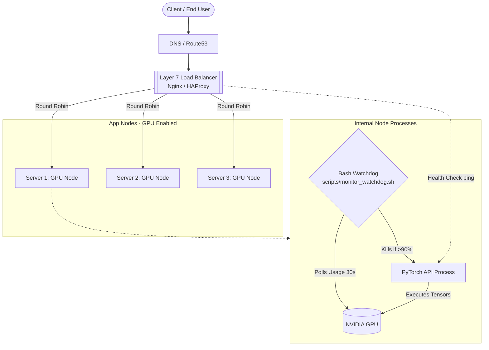

# System Architecture: GPU Ops Toolkit

This document outlines the production request flow and the integration of the GPU Ops Toolkit across a load-balanced 3-server cluster.

## Request Flow Diagram

## How It Works (The 3-Server Model)

1. **Inbound Traffic:** A user sends an inference request. The Load Balancer receives it and checks which of the three GPU servers (S1, S2, or S3) is currently healthy and has the least active connections.
2. **GPU Execution:** The request is routed to `Server 1`. The PyTorch API process loads the model into the NVIDIA GPU (profiled by our `memory_profile.py` logic).
3. **The Watchdog Failsafe:** While the model runs, `monitor_watchdog.sh` runs silently in the background. If the request causes a massive memory spike, the watchdog detects usage >90%.
4. **Self-Healing:** The watchdog kills the runaway PyTorch process. The Load Balancer detects that `Server 1`'s API is temporarily down and routes new traffic to `Server 2` and `Server 3` while `Server 1` reboots.